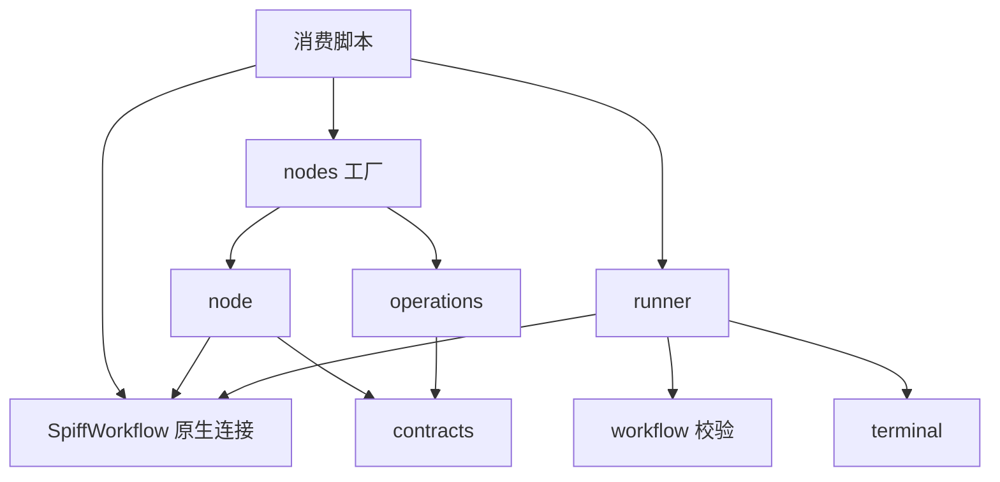

# 当前架构

xxautoenv 让消费者组合本地部署步骤，逐步批准变更，并根据独立核查汇总部署结论。消费者直接连接 SpiffWorkflow 原生节点；SpiffWorkflow 是唯一调度者，运行报告只保存证据。

## 组成与依赖

`contracts.py` 定义输入引用、动作、结果与报告，不依赖引擎。`node.py` 把准备与执行接入原生任务，按本次运行注入的交互能力请求展示和审批。`workflow.py` 读取原生连接，检查数据引用、阶段及最终核查，不另建调度状态。

`operations/` 执行本地命令与文件操作，只依赖标准库及公共数据类型。`nodes/` 的工厂组合这些操作与节点适配。`runner.py` 校验图、绑定交互能力并调用原生 Workflow，最后从原生任务事实和节点结果生成报告。`terminal.py` 使用 Rich 15.0.0 显示阶段计划，负责标准输入输出、确认及完整错误原因链。包初始化不扫描插件或探测工具。

## 一次运行

消费者通过 `main(build, configure=...)` 添加参数并构造图。输入节点校验已提供的 `value`，缺失时询问；`-y` 仅批准动作。阶段开始时，原生引擎先推进只读函数探测，再只读准备路径已确定且输入可得的任务。准备结果保存在原生 task.internal_data；缺少 `Ref` 或分支未确定时延期。阶段计划用 Rich 四列表展示真实准备状态，实际执行复用同一动作或跳过结果；输入交互、命令和核查在计划之后执行。只读或跳过步骤无需变更审批，跳过仍提供下游所需产出。

普通步骤错误停止流程，拒绝与中断保留各自退出语义。独立核查的普通异常转为无法判定并继续；核查完成但不通过也继续其他核查。任一不通过或无法判定使整体失败，契约错误与中断立即停止。每个实际步骤输出一次结果，核查同时显示完成状态与业务结论。探测结果可延后到计划后展示，准备失败或中断时仍保留。报告区分执行、未选择、未执行和路由待定，不参与流程推进。

## 消费与分发

[本地示例](../example/local-file/README.md) 使用原生 `ExclusiveChoice` 选择交付或复用，两条路径提供同名 `FileArtifact`，再由内容、权限核查各自读取。来源由脚本位置确定，产品路径和选择策略都归消费者。文件操作重新核对审批前提，用同目录临时文件替换目标，不跟随目标符号链接。

setuptools 只从 `src/xxautoenv/` 构建公共 wheel，SpiffWorkflow 3.2.0 保持外部依赖。示例通过本地 wheel 安装，不使用 editable 或 workspace。当前验证范围见[验证指南](testing.md)，决策理由及后续边界见[架构记录](agent-notes/implemented/architecture/2026-11-16-public-deployment-library.md)。
